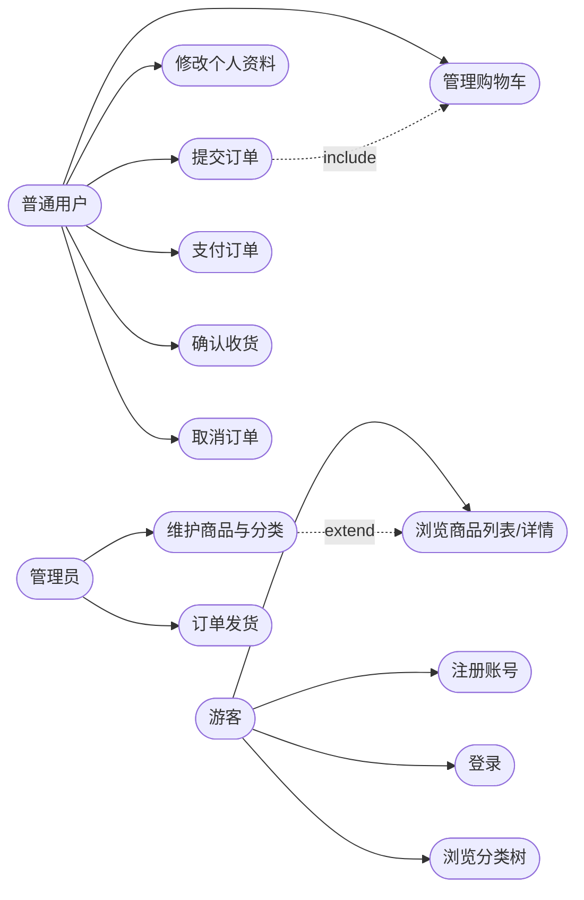
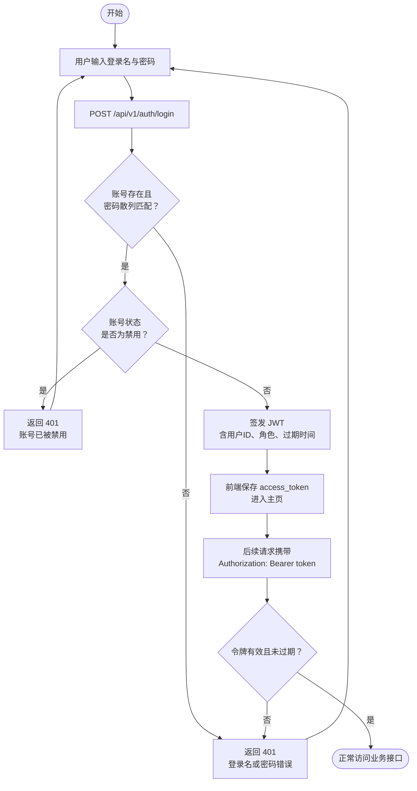
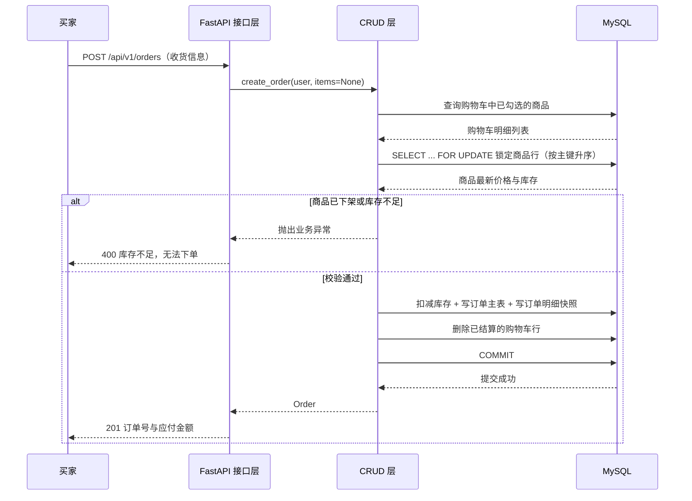
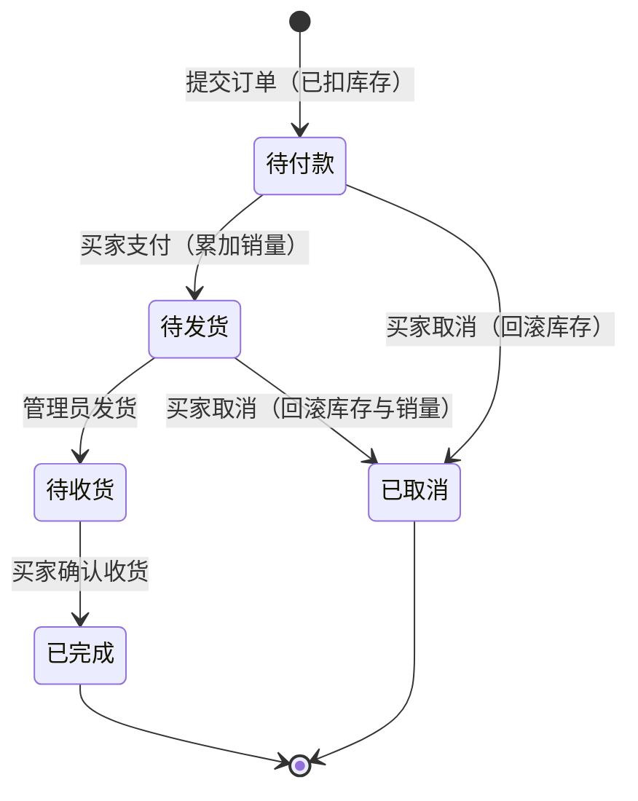
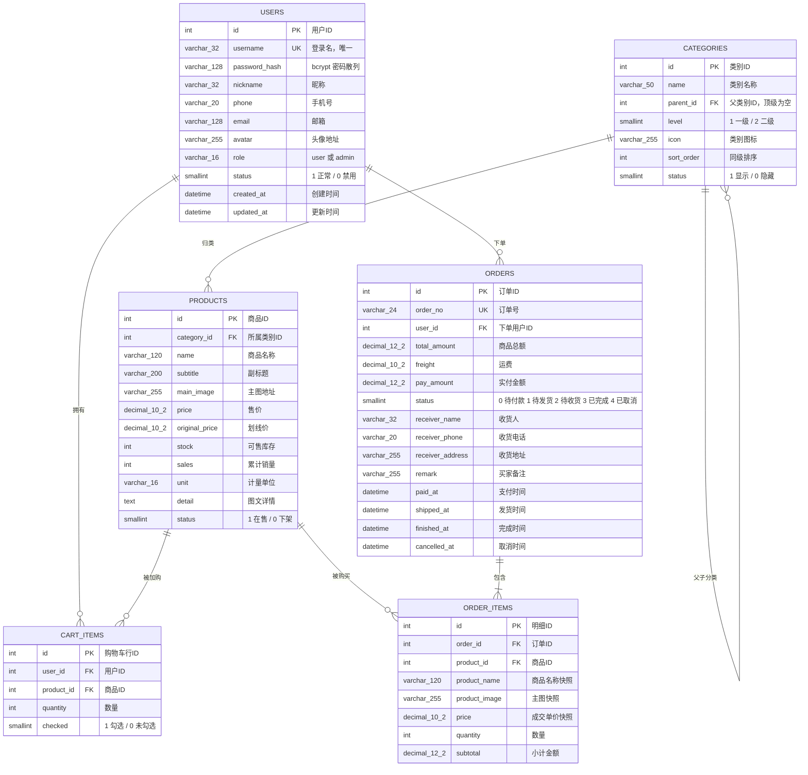

# B2C 商城后端 · 功能设计文档

> 版本：v1.0.0　　编写日期：2026-11-03　　技术栈：Python 3.10+ / FastAPI / SQLAlchemy 2.0 / MySQL 8.0
>
> 本文档包含课程要求的四个部分：**需求分析**、**功能设计（功能图）**、**数据库设计（ER 图）**、**接口文档**。
> 其中接口部分给出约定与清单，逐接口的请求/响应示例见 [接口文档](./接口文档.md)。

---

## 目录

1. [需求分析](#一需求分析)
2. [功能设计与功能图](#二功能设计与功能图)
3. [数据库设计与 ER 图](#三数据库设计与-er-图)
4. [接口设计](#四接口设计)
5. [关键业务规则与实现说明](#五关键业务规则与实现说明)
6. [部署说明](#六部署说明)

---

## 一、需求分析

### 1.1 项目背景

构建一个 B2C（Business to Customer，商家对顾客）商城的**后端服务**，对外提供用户、商品、
购物车、订单四块业务能力。本项目不含前端页面，交付物是可被任意前端调用的 HTTP 接口，
以及配套的接口文档与部署实例。

### 1.2 需求池与取舍

按「初期功能大而全 → 砍掉部分功能 → 保留核心功能」的思路整理需求池：

| 编号 | 需求池中的功能 | 结论 | 取舍理由 |
| --- | --- | --- | --- |
| R01 | 用户注册、登录、个人资料 | **保留** | 一切交易的前提，且是登录流程图的落点 |
| R02 | 两级商品分类的浏览与维护 | **保留** | 商品组织的骨架，接口量小 |
| R03 | 商品发布、改价、上下架、详情 | **保留** | 商城的核心数据 |
| R04 | 商品搜索、分类筛选、价格排序、分页 | **保留** | 列表页必需，实现成本低 |
| R05 | 购物车增删改查与勾选结算 | **保留** | 下单入口，覆盖一对多关系 |
| R06 | 下单、扣库存、订单状态流转 | **保留** | 交易主链路，最能体现后端价值 |
| R07 | 订单取消并回滚库存 | **保留** | 与 R06 同一段逻辑，避免脏数据 |
| R08 | 管理员角色与写操作鉴权 | **保留** | 商品/分类的写接口必须收口，否则任何人可改价 |
| R09 | 收货地址簿（多地址管理） | 砍掉 | 本期把收货信息直接落在订单上，地址簿属于体验增强 |
| R10 | 真实支付对接（微信/支付宝） | 砍掉 | 需要商户资质与回调验签，本期用「模拟支付」接口代替 |
| R11 | 优惠券、满减、积分 | 砍掉 | 价格计算链路会成倍复杂，先保证主流程正确 |
| R12 | 售后、退款、物流轨迹 | 砍掉 | 依赖第三方接口，且不属于最小可交易闭环 |
| R13 | 商品评价与晒单 | 砍掉 | 读多写少，可在交易闭环稳定后追加 |
| R14 | 库存预警、销售统计报表 | 砍掉 | 属于运营侧需求，本期不做 |
| R15 | 秒杀与高并发削峰 | 砍掉 | 需要 Redis/MQ，超出单机 uvicorn 部署范围 |
| R16 | 图片上传与对象存储 | 部分保留 | 头像与商品主图都做真实上传（本地磁盘 + StaticFiles）：头像裁成 256×256 圆形 PNG，主图裁成 800×600 长方形 JPG；库里仍只存 URL 字符串，不接对象存储 |

**最终范围**：R01–R08，共 8 项功能，落在 5 张核心业务表 + 1 张订单明细快照表上。

### 1.3 角色与权限

| 角色 | 说明 | 可执行操作 |
| --- | --- | --- |
| 游客 | 未登录访问者 | 浏览分类树、商品列表与详情 |
| 普通用户 `user` | 注册后的买家 | 游客能力 + 购物车、下单、支付、收货、取消自己的订单、维护个人资料 |
| 管理员 `admin` | 平台运营 | 用户能力 + 分类与商品的增删改、对任意订单发货 |

### 1.4 非功能需求

| 类别 | 要求 |
| --- | --- |
| 数据一致性 | 下单扣库存与写订单明细必须在同一事务内；库存不足不得产生订单 |
| 并发正确性 | 多请求同时购买同一商品时，用 `SELECT ... FOR UPDATE` 行锁串行化，杜绝超卖 |
| 安全性 | 密码只存 bcrypt 散列；JWT 校验签名与有效期；越权访问他人订单返回 403 |
| 可读性 | 所有接口返回统一响应体，错误带中文提示；`/docs` 自动生成 OpenAPI 文档 |
| 可部署性 | 前端构建产物与接口由同一个 `uvicorn` 进程托管，单条命令即可在公网服务器运行；建库脚本与播种脚本独立可执行 |
| 可观测性 | `/health` 同时探测进程与数据库连通性，便于部署后排障 |

---

## 二、功能设计与功能图

### 2.1 系统总体功能结构图

```mermaid
graph TD
    ROOT["B2C 商城后端服务<br/>FastAPI + SQLAlchemy + MySQL"]

    ROOT --> M1["用户与登录"]
    ROOT --> M2["商品类别"]
    ROOT --> M3["商品"]
    ROOT --> M4["购物车"]
    ROOT --> M5["订单"]

    M1 --> M1a["注册账号"]
    M1 --> M1b["登录换取 JWT"]
    M1 --> M1c["查看当前用户"]
    M1 --> M1d["修改个人资料"]

    M2 --> M2a["分类树查询"]
    M2 --> M2b["分类平铺列表"]
    M2 --> M2c["新建/修改/删除分类<br/>仅管理员"]

    M3 --> M3a["商品分页列表"]
    M3 --> M3b["关键词搜索"]
    M3 --> M3c["分类与价格区间筛选"]
    M3 --> M3d["价格/销量排序"]
    M3 --> M3e["商品详情"]
    M3 --> M3f["发布/修改/下架商品<br/>仅管理员"]

    M4 --> M4a["查看购物车"]
    M4 --> M4b["加入购物车<br/>重复加购累加"]
    M4 --> M4c["修改数量与勾选"]
    M4 --> M4d["移除单件/清空"]

    M5 --> M5a["提交订单<br/>扣减库存"]
    M5 --> M5b["我的订单列表"]
    M5 --> M5c["订单详情"]
    M5 --> M5d["支付订单"]
    M5 --> M5e["发货<br/>仅管理员"]
    M5 --> M5f["确认收货"]
    M5 --> M5g["取消订单<br/>回滚库存"]
```



### 2.2 用例图



### 2.3 登录流程图

对应需求脑图中的「开始 → 用户输入 → 登录 → 是否正确 → 进入主页」：



### 2.4 下单时序图



### 2.5 订单状态机



状态用 `SMALLINT` 存储：`0 待付款 / 1 待发货 / 2 待收货 / 3 已完成 / 4 已取消`。
接口只允许沿上图的箭头流转，非法流转返回 `400`，提示「当前状态为「X」，不能执行该操作」。

---

## 三、数据库设计与 ER 图

### 3.1 库与表清单

- 数据库名：`ebusiness_mall`
- 字符集/排序规则：`utf8mb4` / `utf8mb4_0900_ai_ci`（支持中文与 emoji）
- 存储引擎：InnoDB（事务 + 行级锁，下单扣库存的前提）

| 表名 | 中文名 | 说明 |
| --- | --- | --- |
| `users` | 用户表 | 账号、密码散列、角色与状态 |
| `categories` | 商品类别表 | 自关联两级分类树 |
| `products` | 商品表 | 价格、库存、销量与上下架状态 |
| `cart_items` | 购物车表 | 用户与商品的购买意向，带唯一约束 |
| `orders` | 订单主表 | 收货信息、金额与状态 |
| `order_items` | 订单明细表 | 下单时的商品名称/价格快照 |

建表脚本：[sql/01_schema.sql](../sql/01_schema.sql)（由 ORM 模型反向生成，与代码永不脱节）
演示数据：[sql/02_seed.sql](../sql/02_seed.sql)

### 3.2 ER 图



### 3.3 关系与约束设计说明

| 关系 | 基数 | 实现 | 删除策略 |
| --- | --- | --- | --- |
| 用户 → 购物车行 | 1:N | `cart_items.user_id` | `ON DELETE CASCADE`：注销用户即清空购物车 |
| 用户 → 订单 | 1:N | `orders.user_id` | `ON DELETE RESTRICT`：有订单的账号不允许物理删除 |
| 分类 → 分类 | 1:N 自关联 | `categories.parent_id` | `ON DELETE CASCADE`：删父级连带子级（业务层已禁止有子级时删除） |
| 分类 → 商品 | 1:N | `products.category_id` | `ON DELETE RESTRICT`：分类下有商品不允许删除 |
| 商品 → 购物车行 | 1:N | `cart_items.product_id` | `ON DELETE CASCADE` |
| 商品 → 订单明细 | 1:N | `order_items.product_id` | `ON DELETE RESTRICT`：历史订单必须可追溯 |
| 订单 → 订单明细 | 1:N | `order_items.order_id` | `ON DELETE CASCADE` |
| 购物车唯一性 | — | `uk_cart_user_product (user_id, product_id)` | 同一用户同一商品只保留一行，重复加购累加数量 |

**为什么订单明细要存快照字段**：商品可以随时改价改名，若订单只存 `product_id`，
历史订单金额会随商品变动而改变，对账必然出错。因此 `product_name / product_image / price`
在下单瞬间写入明细表，之后商品怎么改都不影响已成交订单。

**索引用途**：

| 索引 | 字段 | 支撑的查询 |
| --- | --- | --- |
| `ix_users_username`（唯一） | `username` | 登录、注册查重 |
| `idx_users_phone` | `phone` | 按手机号找账号 |
| `idx_categories_parent` | `parent_id` | 拼分类树 |
| `idx_products_category` | `category_id` | 分类下钻查商品 |
| `idx_products_status` | `status` | 只查在售商品 |
| `uk_cart_user_product`（唯一） | `user_id, product_id` | 购物车幂等加购 |
| `idx_orders_user_status` | `user_id, status` | 「我的订单」按状态筛选 |
| `order_no`（唯一） | `order_no` | 订单号查询与防重 |

---

## 四、接口设计

### 4.1 通用约定

| 项目 | 约定 |
| --- | --- |
| 基础路径 | `/api/v1`（与需求脑图中的 `http://127.0.0.1/api/v1/useradd` 保持同一风格） |
| 数据格式 | 请求与响应均为 `application/json; charset=utf-8` |
| 鉴权 | 登录后请求头携带 `Authorization: Bearer <access_token>` |
| 响应结构 | 固定三层：`{"code": 0, "message": "success", "data": ...}` |
| 成功 | HTTP `200`（创建类为 `201`）且 `code = 0` |
| 失败 | HTTP 4xx/5xx，`data` 为 `null`，`message` 为可直接展示的中文提示 |
| 分页 | `page` 从 1 开始，`page_size` 默认 10；响应含 `items/total/page/page_size/pages` |
| 金额 | 数据库用 `DECIMAL(x,2)` 存储，JSON 中**以字符串返回**并固定两位小数（如 `"3999.00"`），避开浮点精度问题 |
| 时间 | `YYYY-MM-DDTHH:MM:SS`（服务器本地时间） |

### 4.2 错误码表

| `code` | HTTP | 含义 | 典型场景 |
| --- | --- | --- | --- |
| `0` | 200/201 | 成功 | — |
| `40000` | 400 | 参数或业务规则不通过 | 库存不足、订单状态不允许该操作 |
| `40100` | 401 | 未登录或凭证失效 | 密码错误、令牌过期、账号被禁用 |
| `40300` | 403 | 无权限 | 普通用户调用管理员接口、操作他人订单 |
| `40400` | 404 | 资源不存在 | 商品/分类/订单 ID 不存在 |
| `40900` | 409 | 数据冲突 | 登录名已注册、分类下有商品不能删 |
| `42200`* | 422 | 字段校验失败 | 用户名格式不对、数量超出范围 |
| `50000` | 500 | 服务器内部错误 | 未预期的异常 |

\* 422 由 FastAPI 校验层抛出，响应体中 `code` 取 `40000`，`message` 已指明具体字段。

### 4.3 接口清单

**用户与登录**

| 方法 | 路径 | 说明 | 权限 |
| --- | --- | --- | --- |
| POST | `/api/v1/auth/register` | 注册新用户 | 公开 |
| POST | `/api/v1/auth/login` | 登录换取 JWT | 公开 |
| GET | `/api/v1/auth/me` | 查看当前登录用户 | 登录 |
| POST | `/api/v1/auth/avatar` | 上传头像（multipart，落盘 uploads/avatars） | 登录 |
| PUT | `/api/v1/auth/me` | 修改个人资料 | 登录 |

**商品类别**

| 方法 | 路径 | 说明 | 权限 |
| --- | --- | --- | --- |
| GET | `/api/v1/categories/tree` | 一级带二级的分类树 | 公开 |
| GET | `/api/v1/categories` | 分类平铺列表 | 公开 |
| GET | `/api/v1/categories/{id}` | 分类详情 | 公开 |
| POST | `/api/v1/categories` | 新建分类 | 管理员 |
| PUT | `/api/v1/categories/{id}` | 修改分类 | 管理员 |
| DELETE | `/api/v1/categories/{id}` | 删除分类 | 管理员 |

**商品**

| 方法 | 路径 | 说明 | 权限 |
| --- | --- | --- | --- |
| GET | `/api/v1/products` | 列表：分页/搜索/筛选/排序 | 公开 |
| POST | `/api/v1/products/image` | 上传商品主图（multipart，落盘 uploads/goods） | 管理员 |
| GET | `/api/v1/products/{id}` | 商品详情 | 公开 |
| POST | `/api/v1/products` | 发布商品 | 管理员 |
| PUT | `/api/v1/products/{id}` | 修改商品 | 管理员 |
| DELETE | `/api/v1/products/{id}` | 下架商品 | 管理员 |

**购物车**

| 方法 | 路径 | 说明 | 权限 |
| --- | --- | --- | --- |
| GET | `/api/v1/cart` | 查看购物车与合计 | 登录 |
| POST | `/api/v1/cart` | 加入购物车 | 登录 |
| PUT | `/api/v1/cart/{item_id}` | 改数量或勾选状态 | 登录 |
| DELETE | `/api/v1/cart/{item_id}` | 移除一件 | 登录 |
| DELETE | `/api/v1/cart` | 清空购物车 | 登录 |

**订单**

| 方法 | 路径 | 说明 | 权限 |
| --- | --- | --- | --- |
| POST | `/api/v1/orders` | 提交订单（扣库存） | 登录 |
| GET | `/api/v1/orders` | 订单列表；管理员可传 `all=true` 查看全站订单（发货台用） | 登录 |
| GET | `/api/v1/orders/{id}` | 订单详情 | 本人或管理员 |
| PUT | `/api/v1/orders/{id}/payment` | 支付订单（模拟） | 本人 |
| PUT | `/api/v1/orders/{id}/shipment` | 发货 | 管理员 |
| PUT | `/api/v1/orders/{id}/receipt` | 确认收货 | 本人 |
| PUT | `/api/v1/orders/{id}/cancellation` | 取消订单（回滚库存） | 本人 |

**服务状态**

| 方法 | 路径 | 说明 | 权限 |
| --- | --- | --- | --- |
| GET | `/health` | 进程与数据库连通性 | 公开 |
| GET | `/docs` | Swagger UI 交互式接口文档 | 公开 |
| GET | `/openapi.json` | OpenAPI 3 规范原文 | 公开 |

> 每个接口的字段定义、请求与响应实例见 [接口文档](./接口文档.md)，
> 机器可读版本见 [docs/openapi.json](./openapi.json)。

---

## 五、关键业务规则与实现说明

| 规则 | 具体口径 | 代码位置 |
| --- | --- | --- |
| 运费 | 商品总额满 99 元包邮，否则运费 10 元；`pay_amount = total_amount + freight` | `backend/app/crud/order.py` |
| 库存扣减时机 | **下单即扣**，付款不再重复扣；取消时回滚 | `crud/order.py::create_order` |
| 销量累加时机 | **支付成功**才累加 `products.sales`，取消已支付订单则回退 | `crud/order.py::pay` / `cancel` |
| 防超卖 | 按商品主键升序 `SELECT ... FOR UPDATE` 加行锁，锁内校验库存 | `crud/product.py::lock_for_update` |
| 加锁顺序 | 先按 `product_id` 升序排序再锁，避免两个订单交叉持锁导致死锁 | 同上 |
| 重复加购 | 命中 `uk_cart_user_product` 唯一约束则累加数量并置为勾选 | `crud/cart.py::add` |
| 购物车结算 | 只结算 `checked = 1` 的行，下单成功后删除这些行 | `crud/order.py::create_order` |
| 直接购买 | 下单请求带 `items` 数组时不走购物车 | `api/v1/orders.py` |
| 密码存储 | bcrypt 散列，输入超过 72 字节按 72 字节截断 | `core/security.py` |
| 登录防枚举 | 「用户不存在」与「密码错误」返回同一句提示 | `crud/user.py::authenticate` |
| 令牌载荷 | `sub`=用户ID、`role`=角色、`iat`/`exp`；默认有效期 120 分钟 | `core/security.py` |
| 分类层级 | 最多两级；在二级分类下再建子分类返回 409 | `crud/category.py::create` |
| 删除保护 | 分类下有子分类或有商品时禁止删除，并给出数量提示 | `crud/category.py::delete` |
| 下架语义 | 商品「删除」= 置 `status=0`，历史订单明细仍可展示 | `crud/product.py::delete` |
| 订单号 | `yyyyMMddHHmmssSS` + 5 位随机数，唯一索引兜底 | `crud/order.py::_order_no` |

---

## 六、部署说明

### 6.1 本地运行

```bash
# 1. 建虚拟环境并装依赖
python -m venv .venv
.venv/bin/pip install -r requirements.txt        # Windows 为 .venv\Scripts\pip.exe

# 2. 准备配置
cp .env.example .env                              # 修改 MySQL 账号密码与 JWT 密钥

# 3. 建库建表 + 播种演示数据（二选一）
.venv/bin/python -m scripts.init_db               # 推荐，走 ORM
mysql -u root -p < sql/01_schema.sql              # 或执行纯 SQL
mysql -u root -p < sql/02_seed.sql

# 4. 启动
.venv/bin/uvicorn backend.app.main:app --reload --host 127.0.0.1 --port 8000
```

浏览器打开 <http://127.0.0.1:8000/docs> 即可调试接口。前端本地开发用 `cd frontend && npm run dev`
（Vite 把 `/api`、`/uploads`、`/health` 代理到 8000）；`npm run build` 之后，后端启动时检测到
`frontend/dist/index.html` 会把页面与接口一起提供，直接访问 <http://127.0.0.1:8000/> 就是商城。

### 6.2 公网服务器部署（uvicorn，不用 docker 与 nginx）

前端产物先在本地构建再上传，服务器不需要 Node、也不需要 nginx：

```bash
# 本地
cd frontend && npm run build
scp -r frontend/dist ubuntu@<公网IP>:/opt/ebusiness/frontend/

# 服务器上，项目放在 /opt/ebusiness（首次部署先 cp .env.example .env 并填好 MySQL 与 JWT_SECRET）
cd /opt/ebusiness
git pull
bash scripts/deploy_ubuntu.sh 8000       # 脚本会装依赖、建库、后台拉起 uvicorn 并自检
```

安全组需放行入方向 TCP `8000`。验证：

```bash
curl http://<公网IP>:8000/health                       # 接口与数据库连通
curl http://<公网IP>:8000/ | grep 'id="app"'            # 根路径返回 SPA 外壳
curl http://<公网IP>:8000/api/v1/products?page_size=1   # 业务接口未被静态托管吃掉
```

页面用 history 路由，所以后端把未知非接口路径统一兜底回 `index.html`，任意子页面直接刷新都能打开；
`/api/v1/*` 下不存在的路径仍然返回 JSON 404，不会被兜底掩盖。

### 6.3 端到端自测

```bash
.venv/bin/python -m scripts.smoke_test --base http://127.0.0.1:8000
```

脚本按真实用户顺序跑完「注册 → 登录 → 浏览分类商品 → 加购 → 改数量 → 下单 → 支付 →
发货 → 收货 → 取消回滚 → 头像上传与类型/大小校验 → 权限负例（含普通用户查全站订单被拒）
→ 上下架」共 32 项检查，逐项打印 PASS/FAIL。本机实测结果：32/32 通过。
